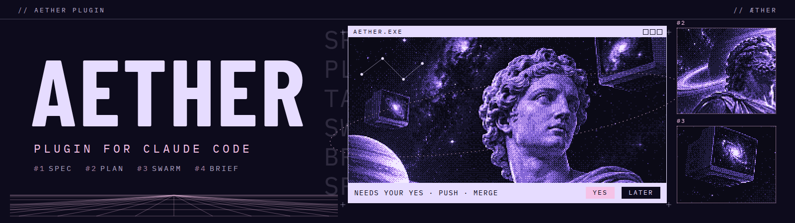
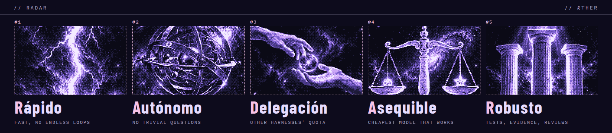

<p align="center"></p>

# Aether Plugin

<!-- hero: Clawd, swamped with tasks, is struck by a cosmic bolt, becomes Aether, hands the work to three subagents and shows a brief -->
<p align="center"></p>

A plugin for Claude Code that adds an opt-in **Aether mode**: an accountable orchestrator, the Lead, that turns the owner's intent into a reviewed spec and plan, builds it with a parallel swarm of agents and with the other coding plans the owner pays for, and reports in one brief.

The Lead writes the owner's intent card and launches `/aether:design`, which runs the Writer and the Judge on their own until the spec, the plan and the tasks are approved. Then the Lead builds the plan itself, through delegate tasks, or with the swarm in parallel.

Plain `claude` stays normal mode.

<p align="center">  </p>

Version 0.36.0 ([changelog](docs/changelog.md))

## Quick start

1. Paste this line in a terminal. It installs the plugin and opens Claude Code with its setup:
   ```
   claude plugin install aether --marketplace DarkArty07/aether-plugin && claude "/aether:setup"
   ```
2. Answer the setup's questions, then close the terminal.
3. Open a new terminal in your project's folder and type `aeth`.
4. Tell the Lead what you want.

On the days after, only step 3. The [install guide](docs/tutorials/install-and-start.md) shows each step and what you see ([en español](docs/es/guias/instalar-y-arrancar.md)).

Aether pursues five goals, and their initials, in Spanish, spell one word: **RADAR**.

<p align="center"></p>

- **Rápido** (fast): fast, cheap models do the bulk of the work, and nothing iterates without end;
- **Autónomo** (autonomous): the owner is not asked about trivial things, and every irreversible step reaches them in one list;
- **Delegación** (delegation): work goes to other coding harnesses (agy, Codex, Grok, Cursor, Muse) while their quota lasts;
- **Asequible** (affordable): each role runs on the cheapest model and effort that does it well;
- **Robusto** (robust): quality code, checked by tests, evidence and independent reviews.

## Requirements

- Claude Code 2.1.294 or later;
- Node.js 22;
- git 2.36 or later;
- for superdelegation, the CLI of each harness you turn on: `agy`, `codex`, `grok`, `cursor-agent` or `muse`.

## Install

```
claude plugin install aether --marketplace DarkArty07/aether-plugin
```

The line of Quick start runs this command and then `/aether:setup`. The setup checks what it can by itself (Claude Code, Node, git, Dynamic workflows, the harness CLIs you have), asks two questions, how `aeth` handles permissions and whether to send work to the other harnesses it found, and puts the short command `aeth` on your `PATH`. Run it again whenever you want to change those answers, and run `/aether:doctor` when something does not work. [Options](docs/guide/options.md#options) has the plugin's eight options and how to set them by hand.

## First start

`aeth` starts Aether mode in the folder you open it in, and `aeth -c` continues the last conversation. By default it works autonomously: no permission prompts, while aether-guard refuses a push, a merge to `main`, a deploy or a forced delete that you have not said yes to. It also gives that session the plugin's own color theme, Aether, and only that session.

Without the short command, Aether mode is chosen per session with:

```
claude --agent aether:lead --effort xhigh
```

The Lead is the agent `aether:lead`, which starts on Sonnet; `--effort xhigh` sets its effort, because a plugin's settings cannot. In a clone of this repository, `scripts/aether-lead` is the same launcher as `aeth`.

Plain `claude` is the normal mode, and the plugin is dormant there, unless the repository sets the agent: put `{ "agent": "aether:lead" }` in its `.claude/settings.local.json`. [Start](docs/getting-started.md#start) has the launcher in full, and [Getting started](docs/getting-started.md) what happens to your first request.

## Where to go

- [Step-by-step guides](docs/tutorials/install-and-start.md): install and start, your first request, a whole feature, the brief, working for hours, other harnesses, the spend, updating ([en español](docs/es/index.md)).
- [What Aether adds](docs/what-aether-adds.md): every command, agent and option it adds, point by point, and a cheat sheet ([en español](docs/es/que-agrega-aether.md)).
- [Getting started](docs/getting-started.md): the install, the first start, and what the Lead does with your first request.
- [Purpose](docs/purpose.md): why Aether exists, the five goals of RADAR and the principles it follows.
- [Methodology](docs/methodology.md): the roles, the three paths and the swarm, from your request to a merged result.
- [Delegates](docs/guide/delegates.md): how a delegate task of the Lead climbs from Haiku to Sonnet and Opus, corrected on top of its own work, and what the system logs of it.
- [Self-observation](docs/guide/observe.md): how `aether-observe` finds the plugin's own faults and out-of-date settings in a Lead session, and why nothing leaves your machine, but for the automatic issues of its development mode.
- [Documentation](docs/index.md): every guide, the reference, the changelog and the design record.

## License

Aether Plugin is open source under the [MIT License](LICENSE). The implementer, supervisor and reviewer agents adapt prompt templates of [superpowers](https://github.com/obra/superpowers), the Aether preset adapts [GitHub Spec Kit](https://github.com/github/spec-kit)'s templates, and several pieces port ideas from [oh-my-claudecode](https://github.com/Yeachan-Heo/oh-my-claudecode), all under the MIT License; [`plugins/aether/NOTICE`](plugins/aether/NOTICE) has the details. The plugin directory carries its own copy of the license.
