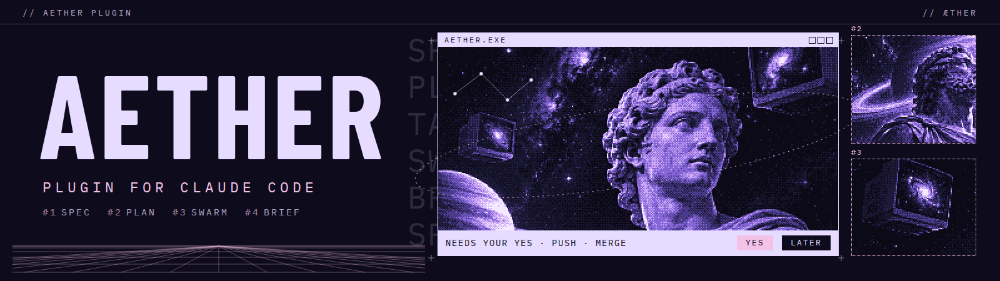
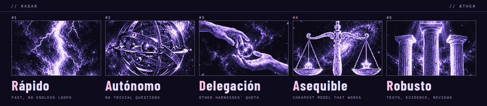

<p align="center"></p>

# Aether Plugin

<!-- hero: the mascot, struck by lightning, becomes Claude Aether, calls three crabs and shows a brief -->
<p align="center"></p>

A plugin for Claude Code that adds an opt-in **Aether mode**: an accountable orchestrator, the Lead, that turns the owner's intent into a reviewed spec and plan, builds it with a parallel swarm of agents and with the other coding plans the owner pays for, and reports in one brief.

The Lead writes the owner's intent card and launches `/aether:design`, which runs the Writer and the Judge on their own until the spec, the plan and the tasks are approved. Then the Lead builds the plan itself, through delegate tasks, or with the swarm in parallel.

Plain `claude` stays normal mode.

<p align="center">  </p>

Version 0.19.2 ([changelog](docs/changelog.md))

Aether serves five goals, **RADAR**.

<p align="center"></p>

- **Rápido** (fast): fast, cheap models do the bulk of the work, and nothing iterates without end;
- **Autónomo** (autonomous): the owner is not asked about trivial things, and every irreversible step reaches them in one list;
- **Delegación** (delegation): work goes to other coding harnesses (agy, Codex, Grok, Cursor, Muse) while their quota lasts;
- **Asequible** (affordable): each role runs on the cheapest model and effort that does it well;
- **Robusto** (robust): quality code, checked by tests, evidence and independent reviews.

## Requirements

- Claude Code 2.1.294 or later;
- Node.js 22;
- git 2.36 or later;
- for superdelegation, the CLI of each harness you turn on: `agy`, `codex`, `grok`, `cursor-agent` or `muse`.

## Install

```
claude plugin install aether --marketplace DarkArty07/aether-plugin
```

Add `--config superdelegation=true` to send everything that is not the Lead to other harnesses (`superdelegation`, off by default; the rule is in [Lanes](docs/guide/lanes.md#lanes), and [Options](docs/guide/options.md#options) has the plugin's six options and how to set them).

## First start

Aether mode is chosen per session:

```
claude --agent aether:lead --effort xhigh
```

The Lead is the agent `aether:lead`, which starts on Sonnet; `--effort xhigh` sets its effort, because a plugin cannot; the command passes it on every start, so the Lead does not depend on the settings file. In a clone of this repository, `scripts/aether-lead` runs that command for you, with permissions bypassed and with aether-guard refusing an irreversible command that no grant covers. It also gives that session the plugin's own color theme, Aether, and only that session.

With the plugin installed and no clone, run `/aether:first-setup` once in a session. It puts a short command, `aeth` unless you name another, in `~/.local/bin`; the command runs the same launcher of the newest installed release, so an update needs no second setup, and it never replaces a file that is not its own.

Plain `claude` is the normal mode, and the plugin is dormant there, unless the repository sets the agent: put `{ "agent": "aether:lead" }` in its `.claude/settings.local.json`. That file can hold `xhigh` as `effortLevel`, but the command above passes `--effort xhigh` itself, so it is the way that always starts the Lead there.

Then tell the Lead what you want. [Start](docs/getting-started.md#start) has the launcher in full, and [Getting started](docs/getting-started.md) what happens to your first request.

## Where to go

- [Getting started](docs/getting-started.md): the install, the first start, and what the Lead does with your first request.
- [Purpose](docs/purpose.md): why Aether exists, the five goals of RADAR and the principles it follows.
- [Methodology](docs/methodology.md): the roles, the three paths and the swarm, from your request to a merged result.
- [Delegates](docs/guide/delegates.md): how a delegate task of the Lead climbs from Haiku to Sonnet and Opus, corrected on top of its own work, and what the system logs of it.
- [Documentation](docs/index.md): every guide, the reference, the changelog and the design record.

## License

Aether Plugin is open source under the [MIT License](LICENSE). The implementer, supervisor and reviewer agents adapt prompt templates of [superpowers](https://github.com/obra/superpowers), the Aether preset adapts [GitHub Spec Kit](https://github.com/github/spec-kit)'s templates, and several pieces port ideas from [oh-my-claudecode](https://github.com/Yeachan-Heo/oh-my-claudecode), all under the MIT License; [`plugins/aether/NOTICE`](plugins/aether/NOTICE) has the details. The plugin directory carries its own copy of the license.
